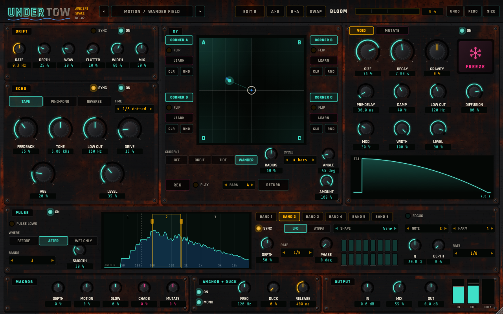
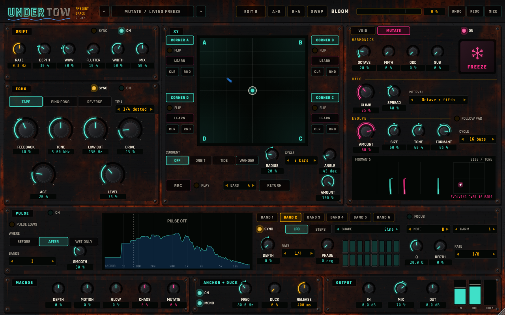

# UNDERTOW

An ambient space effect for Logic Pro (Audio Unit, Apple Silicon and Intel): slow movement, tape echo, a huge reverb with FREEZE, frequency bands that throb in time, a sound-design page that grows harmonics and keeps the space evolving, and an XY pad for pushing variations in and out. It keeps the low end of a bass dry and solid, so it sits well after a heavy synth like [NEON RIOT](https://github.com/robcawley/neon-riot).

> Made by **Rob Cawley**, a musician in Dublin, for his own records, and shared free for anyone to try.
> If you make something with it, I'd love to hear it. Share it in [Made with it](https://github.com/robcawley/undertow/discussions/categories/made-with-it) or post it anywhere, and if you like, link back to my music:
> **[robcawley.com](https://robcawley.com)** · **[Bandcamp](https://robcawley.bandcamp.com)** · the new album **[Room Tone](https://robcawley.com/roomtone/)**.

## What it does

- **ANCHOR + DUCK.** Everything below the anchor frequency stays dry, centred and out of the effects. DUCK pushes the space down while you play and lets it rise in the gaps.
- **DRIFT.** Slow chorus, vibrato and tape wow and flutter before the space.
- **ECHO.** Tape, ping-pong or reverse delay, synced or free, with tone, low cut, drive and AGE (each repeat wobbles and darkens a little more).
- **VOID.** A reverb from a room to a near-endless wash. GRAVITY makes the tail drop away early or swell before it fades. FREEZE holds the tail as a drone.
- **MUTATE.** HARMONICS adds an octave, a fifth, odd harmonics or a sub before the space. HALO feeds the tail back into the reverb pitch-shifted, so it climbs (or sinks) on every pass. EVOLVE slowly breathes the reverb's size and tone and slides vowel-like resonances through the tail, in time with the song and the same every time you play the same bar.
- **PULSE.** Split the space into up to six bands and make each one throb at its own synced rate, shape and phase, or follow a 16-step pattern. FOCUS adds narrow peaks on a chosen note and its harmonics that pulse in time.
- **XY pad.** Each corner holds a variation that the pad adds in (or, flipped, subtracts) as you move towards it. LEARN a corner by moving knobs; CURRENT moves the puck by itself; REC records a path that loops with the song.
- **Scenes and BLOOM.** Set a second scene and BLOOM morphs between the two, so one automation lane can carry a whole arc.
- **Macros.** DEPTH, MOTION, GLOW, CHAOS and MUTATE push the sound one way or the other from the middle.
- **80 factory presets:** BASS SPACE, DRONE, PULSE, MOTION, MUTATE, CINEMATIC, SHIMMER, FROZEN (made to be frozen), RHYTHMIC, ECHOES and TEXTURE, plus **RIOT PAIRS**: sixteen presets made for the NEON RIOT patches of the same name. Load the same name in both.
- Everything can be automated, grouped by section in Logic's automation menu, and every change can be undone. The window scales from 75 % to 200 %.

## Download

Get the ready-built plug-in from the **[latest release](https://github.com/robcawley/undertow/releases/latest)** (macOS 12 or later, Apple Silicon and Intel).

1. Unzip it and move `UNDERTOW.component` into `~/Library/Audio/Plug-Ins/Components` (in Finder: Go → Go to Folder…, then paste that path).
2. The plug-in isn't signed with an Apple developer certificate, so macOS blocks it the first time. Open Terminal and run:

       xattr -dr com.apple.quarantine ~/Library/Audio/Plug-Ins/Components/"UNDERTOW.component"

3. Restart Logic. It appears under Audio FX → Audio Units → Rob Cawley → UNDERTOW.

## Build from source

Or build it yourself on a Mac with the Xcode Command Line Tools and CMake.

    git clone https://github.com/robcawley/undertow.git
    cd undertow
    git clone --branch 8.0.4 --depth 1 https://github.com/juce-framework/JUCE.git JUCE
    cmake -S . -B build -DCMAKE_BUILD_TYPE=Release
    cmake --build build -j 8 --target Undertow_AU

The build copies the plug-in to `~/Library/Audio/Plug-Ins/Components`. The offline checks are in `Tools/` (build `UndertowRender` and run it with `--bank`, `--mutate`, `--clicks` and so on).

## Sister projects

- [NEON RIOT](https://github.com/robcawley/neon-riot): a heavy bass synthesizer, and UNDERTOW's partner.
- [ROB KIT](https://github.com/robcawley/rob-kit): a human-feeling drum instrument.
- [BRUISER](https://github.com/robcawley/bruiser): a drummer that plays ROB KIT.
- [THE GREAT COMPOSER](https://github.com/robcawley/the-great-composer): chords in, orchestral MIDI out.

## Licence

AGPL-3.0 (see `LICENSE`), the same open-source licence as the JUCE framework it's built on. Fonts: Rajdhani and Share Tech Mono, SIL Open Font Licence.
